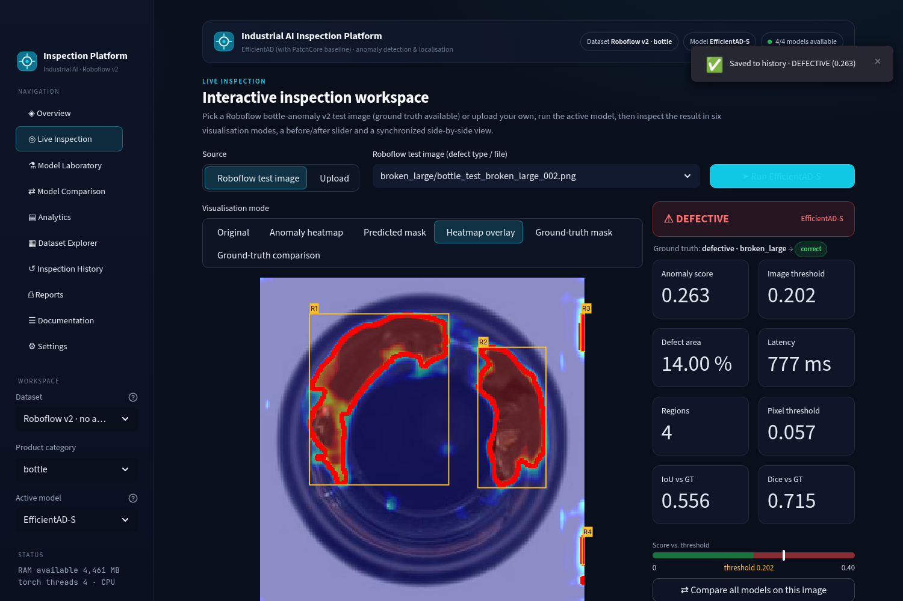

# Industrial Anomaly Detection and Localization using EfficientAD (with PatchCore baseline) on MVTec AD

An **Industrial AI Inspection Platform** (Streamlit, dark theme) for unsupervised visual inspection.
Models learn what a **defect-free** product looks like from normal images only. For a new image they
answer two questions:

* **Is this product defective?** (image-level detection → anomaly score + NORMAL / DEFECTIVE)
* **Where is the defect?** (pixel-level localisation → heatmap, binary mask, defect regions)

The main model is **EfficientAD** (S and M), and **PatchCore** (ResNet18 and WRN-50) is the baseline.
All four are trained on our own **Roboflow dataset**, built from MVTec AD `bottle` with an 80/10/10 split.



## Quick start

```bash
cd /home/aarya/fun/industrial-anomaly-detection-mvp
~/miniconda3/bin/streamlit run app.py
```

Open **http://localhost:8501**. The app uses the Roboflow dataset (`data/roboflow_v2`) by default.
The **Dataset** selector in the sidebar switches the whole website between:

| Dataset | What it is | Models |
|---|---|---|
| **Roboflow v2 · no augmentation (final)** | 160 train / 20 valid / 20 test | all 4 |
| **Roboflow v1 · 7 augmentations** | the same split, train augmented ×3 (480 images) | PatchCore ResNet18 (augmentation study) |
| **Official MVTec AD** | full release (209 train / 83 test) | PatchCore ResNet18 + WRN-50 |

The Dataset Explorer shows the v1 vs v2 comparison on every dataset.
How to show each result on the website is described in [docs/DEMO_GUIDE.md](docs/DEMO_GUIDE.md).
Start Streamlit **from this folder**, because `.streamlit/config.toml` (the dark theme) is read from the
working directory.

If an older instance is already running, stop it (Ctrl+C) and start it again. Helper modules are
not hot-reloaded.

To use the official MVTec AD release instead:
`MVTEC_ROOT=~/fun/industrial-anomaly-detection/data/mvtec_ad ~/miniconda3/bin/streamlit run app.py`

## Results: Roboflow dataset, test split (actual runs)

All four models were scored by the **same code** (`evaluation.evaluate`) on the **same 20 test
images** (10 normal, 10 defective: 3 broken_large, 4 broken_small, 3 contamination).
Thresholds come from **normal validation images only**, never from test data. Pixel metrics use a
256×256 grid. Latency is measured on this laptop's CPU.

| | EfficientAD-S | EfficientAD-M | PatchCore · ResNet18 | PatchCore · WRN-50 |
|---|---|---|---|---|
| Role | **main model** | **main model** | baseline | baseline |
| Trained on | Colab T4 GPU, 2,500 iters (396 s) | Colab T4 GPU, 1,500 iters (646 s) | laptop CPU (222 s) | Colab T4 GPU (146 s) |
| Image AUROC | 0.9500 | 0.8900 | 1.0000 | 1.0000 |
| Image P / R / F1 | 0.900 / 0.900 / 0.900 | 1.000 / 0.500 / 0.667 | 1.000 / 1.000 / 1.000 | 1.000 / 1.000 / 1.000 |
| Image TN / FP / FN / TP | 9 / 1 / 1 / 9 | 10 / 0 / 5 / 5 | 10 / 0 / 0 / 10 | 10 / 0 / 0 / 10 |
| Pixel AUROC | 0.9814 | 0.9407 | 0.9875 | **0.9924** |
| Pixel P / R / F1 | 0.618 / 0.754 / **0.679** | **0.644** / 0.543 / 0.589 | 0.347 / 1.000 / 0.515 | 0.375 / 1.000 / 0.545 |
| Pixel IoU | **0.514** | 0.417 | 0.347 | 0.375 |
| Latency mean (CPU) | 479 ms | 5,744 ms | **60 ms** | 299 ms |

**Reading this:**
* **Final verdict: PatchCore WRN-50 performs best overall.** It gets 20/20 correct and the highest pixel
  AUROC (0.9924). EfficientAD-S gives the best defect outlines (pixel F1 0.679, IoU 0.514), and PatchCore
  ResNet18 is the fastest (60 ms on CPU).
* **PatchCore detects every test image correctly**, and WRN-50 gives the best pixel AUROC.
  PatchCore needs no gradient training, so it reaches its full quality immediately.
* **EfficientAD-S outlines defects best.** Its pixel IoU of 0.51 and pixel precision of 0.62 are much
  higher than PatchCore's 0.35–0.38. PatchCore's masks are much larger than the real defects, while
  EfficientAD's are tighter. EfficientAD-S misses one contamination image and flags one good bottle.
* **EfficientAD-M is weakest here.** It misses 5 of 10 defects (4 broken bottles and 1
  contamination) but raises no false alarm. It is the larger
  network, and it had only 1,500 of the paper's 70,000 iterations, which is too few to converge.
* EfficientAD was trained with a **reduced protocol** (2,500 / 1,500 iterations instead of 70,000)
  because training on this CPU would take ~32 h (S) and ~225 h (M). With full training the paper
  reports EfficientAD above PatchCore; our numbers show the trend after a few minutes of GPU training.
* With only 20 test images, one image changes image AUROC by up to 0.05–0.10. These numbers show
  that each method works on this data; they are not precise benchmark values.

## Roboflow dataset (built from scratch)

200 images of MVTec AD `bottle` were uploaded to a private Roboflow **Anomaly Detection** project
(`bottle-anomaly`). They were labelled normal or anomalous and split **80 / 10 / 10**:

| Split | normal | anomalous |
|---|---|---|
| train | 160 | 0 |
| valid | 10 | 10 (4 broken_large, 3 broken_small, 3 contamination) |
| test | 10 | 10 (3 broken_large, 4 broken_small, 3 contamination) |

Train holds **no anomalous images**. Every model learns only what normal looks like, which is how
unsupervised anomaly detection works and what Roboflow's own docs require.

**Preprocessing** (all splits): Auto-Orient and Stretch to 224×224.

**Augmentation** (train only, ×3) in version **v1**, 7 operations:
1. flip (horizontal)
2. flop (vertical flip)
3. 90° rotation
4. crop / zoom 0–10 %
5. brightness ±10 %
6. exposure ±10 %
7. blur filter 1 px

Version **v2** has no augmentation, as Roboflow recommends for this kind of model.

| Roboflow version | Train images | Image AUROC | Pixel AUROC | Pixel IoU | Build time |
|---|---|---|---|---|---|
| v1 (augmented) | 480 | 1.0000 | 0.9866 | 0.339 | 552 s |
| v2 (no augmentation) | 160 | 1.0000 | **0.9875** | **0.347** | **222 s** |

(PatchCore ResNet18 on both versions.) Augmentation did not help, because flipped and rotated "normal"
bottles only widen what the model accepts as normal. **v2** is therefore the final dataset and the
default. **v1** is still shown in the website: choose *Roboflow v1* in the sidebar to see the 480
augmented training images and the v1 model.

Both versions were exported from Roboflow and converted back to the MVTec folder layout, which
restores the ground-truth masks: `data/roboflow_v1`, `data/roboflow_v2`.

## EfficientAD training on a GPU (Colab)

EfficientAD needs gradient training. On this laptop's CPU, 20 iterations of EfficientAD-S took 3 minutes
and gave chance-level results (image AUROC 0.485). EfficientAD-M did not even finish its set-up step in
10 minutes. Training was therefore moved to a free **Google Colab T4 GPU**:

1. `colab/efficientad_colab_package.zip`: the main platform's EfficientAD code, the distilled teacher
   weights, the Roboflow v2 data and the ImageNet subset used for the penalty loss.
2. `colab/train_efficientad_colab.ipynb`: trains PatchCore WRN-50, EfficientAD-S (2,500 iterations)
   and EfficientAD-M (1,500 iterations), then downloads `roboflow_v2_models.zip`.
3. `python scripts/import_colab_models.py colab/roboflow_v2_models.zip` installs the checkpoints in
   `artifacts/roboflow_v2/main_models/` and evaluates them here, on the same test images.

A device bug was fixed on the way: in the main platform's `trainer.py`, the validation images for the
quantile step were never moved to the GPU.

## Results: official MVTec AD `bottle` (PatchCore only)

With `MVTEC_ROOT` set to the official release, the two PatchCore models were evaluated on the full official
test split (83 images: 20 normal, 63 defective):

| | PatchCore · ResNet18 | PatchCore · WRN-50 |
|---|---|---|
| Image AUROC | 1.0000 | 1.0000 |
| Image TN / FP / FN / TP | 20 / 0 / 1 / 62 | 19 / 1 / 0 / 63 |
| Pixel AUROC | 0.9811 | **0.9892** |
| Pixel IoU | 0.299 | **0.370** |
| Latency mean (CPU) | **59 ms** | 354 ms |

EfficientAD has no checkpoint for the official release (CPU training only), so it appears as
unavailable in that mode.

## Documentation

| Document | Contents |
|---|---|
| [docs/PAGE_GUIDE.md](docs/PAGE_GUIDE.md) | Every page of the web app: purpose, controls, how to read each chart and metric |
| [docs/PROJECT_EXPLANATION.md](docs/PROJECT_EXPLANATION.md) | Theory (EfficientAD, PatchCore), dataset, results, limitations, viva questions with answers |
| [docs/DEMO_GUIDE.md](docs/DEMO_GUIDE.md) | Run commands, every feature, **where to find each result on the website**, 5-minute demo script, troubleshooting |
| [docs/VIVA.md](docs/VIVA.md) | All 53 viva questions with answers (incl. the final verdict), plus key numbers to remember |
| [Project_Presentation.pptx](Project_Presentation.pptx) | 19-slide review deck (generated by `make_presentation.py` from the result files) |
| [docs/PRESENTATION_EXPLANATION.md](docs/PRESENTATION_EXPLANATION.md) | Slide-by-slide guide: what each slide shows, what to say, numbers and their source, likely questions |
| [docs/screenshots/](docs/screenshots/) | `new_*.png` = Roboflow v2 (4 models), `new_v1_*.png` = Roboflow v1 (older files are from the MVTec-only version) |
| [results/reports/](results/reports/) | PDF reports: `report_roboflow_v2_bottle_<model>_*.pdf` (4 models), `report_roboflow_v1_bottle_patchcore_r18_*.pdf` |

All documents can also be read inside the app on the **Documentation** page.

## Platform pages

| Page | What it does |
|---|---|
| *Sidebar* | **Dataset** (Roboflow v2 / v1 / official MVTec AD), product category, active model, RAM status |
| Overview | KPIs, model availability cards, performance and latency charts, dataset overview, recent activity |
| **Live Inspection** | Roboflow test image or upload → verdict, score vs. threshold, defect area, latency, regions, IoU/Dice. **Six visualisation modes:** original, anomaly heatmap, predicted mask, heatmap overlay, ground-truth mask, ground-truth comparison (red = predicted only, green = missed, yellow = overlap). **Before/after slider**, **synchronized view**, region table. |
| Model Laboratory | Checkpoint path and size, training protocol, thresholds, validation-score plot, evaluate / rebuild actions |
| **Model Comparison** | Four model cards; protocol table; AUROC, precision/recall, F1/IoU, latency, size and RAM charts; **side-by-side inference** of all four models on the current image next to the ground truth |
| Analytics | ROC curves, confusion matrices, score distribution vs. threshold, IoU per defect type, latency distribution |
| Dataset Explorer | Split counts and integrity; **v1 vs v2 augmentation study table**; galleries per split / defect type with ground-truth outlines (augmented copies on v1); **Inspect** opens an image in Live Inspection |
| Inspection History | SQLite log with model, verdict, IoU/Dice; filters, CSV export |
| Reports | PDF with dataset, active model's metrics, the 4-model comparison table, the current inspection and limitations |
| Documentation | The guides above, readable in the app |
| Settings | CPU threads, overlay opacity, cache, history clearing, system info |

## Commands

```bash
~/miniconda3/bin/python evaluation.py --category bottle --model patchcore_r18 [--rebuild]
~/miniconda3/bin/python evaluation.py --category bottle --model efficientad_s      # any of the 4 models
~/miniconda3/bin/python -m pytest -q tests          # 22 tests (MVTec + Roboflow v1/v2 + dataset switch), ~2 min

# dataset pipeline
~/miniconda3/bin/python scripts/prepare_roboflow_batches.py --category bottle      # 5 upload batches + manifest
~/miniconda3/bin/python scripts/convert_roboflow_export.py data/roboflow_export/v2 data/roboflow_v2
~/miniconda3/bin/python scripts/import_colab_models.py colab/roboflow_v2_models.zip
```

## Project structure

```
app.py                     Streamlit platform (10 pages)
ui.py                      design system: CSS, header, cards, Plotly theme, image viewers, slider
model.py                   PatchCoreLite (ResNet18): features, coreset memory bank, scoring, calibration
model_registry.py          the four models, real availability checks, main-platform adapter (EfficientAD, WRN-50)
dataset.py                 dataset discovery (Roboflow default / official MVTec AD), validation, loading
evaluation.py              build / calibrate / evaluate any registered model (CLI), metrics
visualization.py           heatmaps, overlays, regions, ground-truth comparison, plots
report.py                  PDF report (reportlab)
history.py                 SQLite inspection history
scripts/                   Roboflow batch preparation, export conversion, Colab notebook + import
colab/                     Colab package, notebook and trained checkpoints (zip files are git-ignored)
data/roboflow_v1, _v2      converted Roboflow exports (git-ignored)
artifacts/roboflow_v2/     ResNet18 memory bank; main_models/ = EfficientAD-S/-M + WRN-50 checkpoints
results/roboflow_v2/       metrics.json + per_image.csv per model
tests/                     test_mvp.py (official MVTec AD), test_roboflow.py (default dataset, 4 models)
docs/                      guides and screenshots
```

## Limitations

* **EfficientAD is trained with a reduced protocol.** It ran for 2,500 / 1,500 iterations instead of
  70,000, so it is weaker than the published model, and EfficientAD-M in particular has not converged.
* **Small test set.** 20 test images from one category (bottle), so the metrics have wide uncertainty.
* PatchCore ResNet18 is a simplified PatchCore: lighter backbone, no 1024-d projection, no Eq. 7
  re-weighting.
* PatchCore's masks are larger than the real defects at the calibrated threshold.
* The Dataset selector changes a process-wide setting, so use one browser session at a time
  (a single-user demo tool).
* Inference latency is measured on a CPU. EfficientAD-M takes ~6 s per image here, but is designed for
  millisecond latency on a GPU.
* Uploaded images of other objects are still scored, and are usually called defective.
