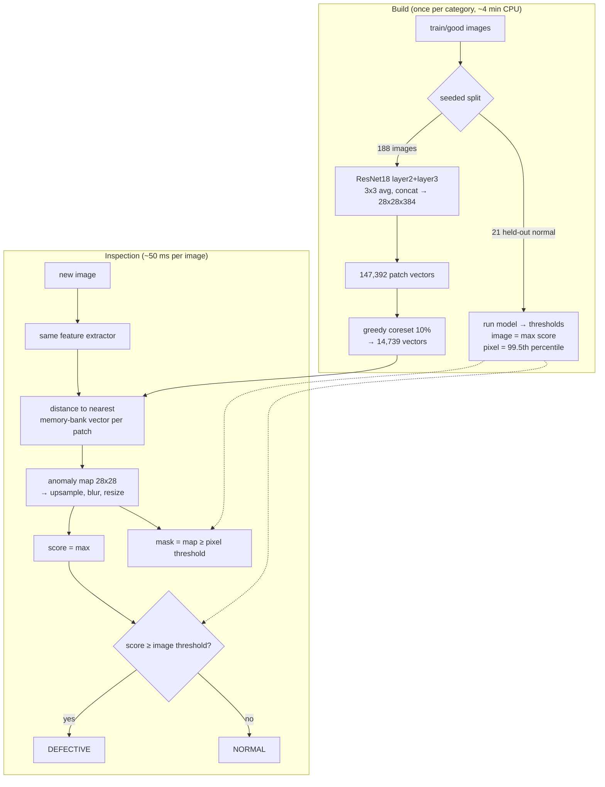

# Project Explanation (for the report and the viva)

**Industrial Anomaly Detection and Localization using EfficientAD (with PatchCore baseline) on MVTec AD**

> **What changed in the final version.**
> * The project now runs on our **own Roboflow dataset**: 200 MVTec AD bottle images, split 80/10/10,
>   with preprocessing and 7 augmentations. See section 17.
> * All four models are trained and compared on it: **EfficientAD-S and -M** (main model, trained on a
>   Colab GPU) and **PatchCore ResNet18 and WRN-50** (baseline). See sections 18–19.
> * The website shows **both Roboflow versions** through the sidebar *Dataset* selector: v2 (final, 4 models) and
>   v1 (7 augmentations, PatchCore ResNet18 for the augmentation study).
> * All viva questions are collected in [VIVA.md](VIVA.md).
> * Sections 1–16 explain the theory and the earlier PatchCore-only work on the official MVTec AD release.

---

## 1. What is industrial anomaly detection?

In a factory, a camera photographs every product. We want to find the **defective** ones
(cracks, scratches, contamination) automatically.

The difficulty: defects are **rare and unpredictable**. You might have thousands of good bottles but
only a handful of broken ones, and next month a defect type you have never seen may appear. So
instead of teaching a model "what a defect looks like" (supervised classification), we teach it
**"what normal looks like"** and flag anything that differs. This is called *unsupervised* (more
precisely, *one-class*) anomaly detection. The model is built from normal images only.

Two tasks:

* **Detection (image level):** is this image normal or defective? → one number, the *anomaly score*.
* **Localisation (pixel level):** which pixels are defective? → an *anomaly map* / heatmap.

## 2. What is MVTec AD?

MVTec AD (Bergmann et al., CVPR 2019) is the standard benchmark for this problem: 15 categories
(10 objects such as bottle, screw and pill; 5 textures such as carpet and wood), 5,354
high-resolution images.

* `train/good`: only defect-free images (used to build the model).
* `test/good` + `test/<defect type>`: normal and defective images (used for evaluation).
* `ground_truth/<defect type>/*_mask.png`: a pixel-accurate mask of each defect.

**Bottle, used here:** 209 training images; 83 test images (20 good, 63 defective of three types:
`broken_large`, `broken_small`, `contamination`); 63 masks; 900×900 pixels.

## 3. What is PatchCore?

PatchCore (Roth et al., "Towards Total Recall in Industrial Anomaly Detection", CVPR 2022) is a
simple and very strong method:

1. Run normal images through a CNN pretrained on ImageNet and keep mid-level feature maps.
2. Every spatial position of the feature map describes a small **patch** of the image. Store all
   these patch vectors from all normal images in a **memory bank**.
3. For a test image, compute its patch vectors and, for each one, find the **nearest** patch in the
   memory bank. A large distance means "this patch looks like nothing I have seen in normal
   images", i.e. anomalous.
4. The distances form the anomaly map; the largest distance is the image's anomaly score.

There is **no training** in the usual sense: no loss function, no back-propagation. The
"learning" is just storing examples.

## 4. Why a pretrained ResNet18?

* A network trained on ImageNet (1.2 M photos, 1,000 classes) has learned general visual features:
  edges, textures, shapes. Those features are useful for comparing patches even on products it has
  never seen.
* We have only ~200 normal images per category, far too few to train a deep network from scratch.
* ResNet18 is small (11 M parameters). It runs at ~50 ms per image on a laptop CPU, while the
  WideResNet-50 used in the paper is ~6× larger and slower.
* The backbone is **frozen**: its weights never change.

## 5. What is feature extraction?

A CNN transforms an image into a stack of feature maps. In ResNet18, for a 224×224 input:

| Layer | Output | What it captures |
|---|---|---|
| layer1 | 64 × 56 × 56 | edges, colours (too low level) |
| **layer2** | **128 × 28 × 28** | small textures and parts |
| **layer3** | **256 × 14 × 14** | larger structures |
| layer4 | 512 × 7 × 7 | ImageNet-specific semantics (too coarse, too biased) |

We use **layer2 + layer3** (mid-level, as in the paper):

1. Each map is averaged over a 3×3 neighbourhood, so each position also "sees" its neighbours.
2. layer3 is upsampled to 28×28.
3. The two maps are concatenated.

Result: a **28 × 28 grid of 384-dimensional vectors**, i.e. 784 patch descriptors per image, each
describing a ~8×8 pixel cell of the 224×224 input with context around it.

## 6. What is a memory bank?

The collection of all patch vectors from the normal training images: 188 images × 784 patches =
**147,392 vectors**. Comparing every test patch with all of them is slow and the bank contains a lot
of near-duplicates, so we keep a representative subset with **greedy coreset selection**:

> start with one random vector; repeatedly add the vector that is **farthest** from everything
> chosen so far.

This "k-center" rule keeps the bank spread over the whole space of normal appearances. We keep 10 %
(**14,739 vectors**). Distances during selection are computed on a 128-d random projection to save
time.

## 7. How does nearest-neighbour distance detect anomalies?

For each test patch vector *x*, the anomaly score is

    s(x) = min over m in memory bank of ‖x − m‖₂   (Euclidean distance)

* A normal patch (clean glass, the bottle rim) has a very similar patch in the bank → small distance.
* A crack or contamination produces a feature vector unlike any normal patch → large distance.

**Image score** = the maximum patch score: one strongly abnormal region is enough to reject a product.

## 8. What is an anomaly heatmap?

The 28×28 grid of patch scores, upsampled to the input size, smoothed with a Gaussian blur
(σ = 4 px) and resized to the original image (900×900). It is drawn with the *jet* colour map
(blue = normal, red = anomalous) and blended over the photo (the *overlay*).

The colour scale is fixed per model, not stretched per image. Otherwise a perfectly normal image
would also show a red "hottest" spot.

## 9. What is pixel-level localisation?

Turning the heatmap into a **binary mask**: pixel is defective if its score ≥ the *pixel threshold*.
Comparing that mask with the ground-truth mask measures how well we find **where** the defect is,
not just **whether** there is one.

### How the thresholds were chosen (important for the viva)

We split `train/good` into 188 images for the memory bank and **21 held-out normal images**. These
are run through the model:

* **Image threshold** = the highest image score among the 21 → every held-out normal image is
  accepted. Value: **1.7384**.
* **Pixel threshold** = the 99.5th percentile of all their anomaly-map pixels → about 0.5 % of
  normal pixels are flagged. Value: **1.1383**.

No test image and no ground-truth mask is used to choose them. Choosing thresholds on the test set
would make the reported precision/recall optimistic ("data leakage").

## 10. Evaluation metrics

Confusion matrix (positive = defective):

|  | predicted normal | predicted defective |
|---|---|---|
| actually normal | TN | FP (false alarm) |
| actually defective | FN (missed defect) | TP |

* **Precision** = TP / (TP + FP): of everything we flagged, how much was really defective.
* **Recall** = TP / (TP + FN): of all real defects, how many we caught. *In inspection, missed
  defects are usually the expensive mistake.*
* **F1** = 2·P·R / (P + R): harmonic mean, high only if both are high.
* **Specificity** = TN / (TN + FP): how many good products pass.
* **IoU** (pixel level) = |predicted ∩ true| / |predicted ∪ true|: overlap of the predicted and
  real defect regions (1 = perfect, 0 = no overlap).
* **AUROC**: area under the ROC curve (true-positive rate vs. false-positive rate over **all**
  thresholds). 1.0 = every defective sample scores higher than every normal one; 0.5 = random. It
  does not depend on the chosen threshold, which is why papers report it.

These are computed at two levels:

* **Image level:** one label and one score per image (83 samples on official MVTec AD, 20 on the
  Roboflow test split).
* **Pixel level:** every pixel of every test image, normal images included, on a 256×256 grid
  (83 × 65,536 ≈ 5.4 M pixels on official MVTec AD).

### Our results on bottle (official MVTec AD, PatchCore ResNet18; Roboflow results are in section 19)

| | AUROC | Precision | Recall | F1 | IoU |
|---|---|---|---|---|---|
| Image | 1.0000 | 1.0000 | 0.9841 | 0.9920 | – |
| Pixel | 0.9811 | 0.2989 | 0.9988 | 0.4601 | 0.2988 |

Interpretation:

* Detection is excellent. Every normal image passes, and 62 of 63 defects are caught (one
  `contamination` image scores just below the threshold).
* Localisation: AUROC 0.98 means defective pixels almost always score higher than normal ones. But
  at our threshold the predicted regions are ~3× too large (precision 0.30). Causes: the blur, the
  coarse 28×28 grid (each cell covers ~32×32 original pixels), and a threshold chosen to flag only
  0.5 % of *normal* pixels, which is permissive near defects.

## 11. Limitations

1. **Simplified PatchCore.** ResNet18 instead of WideResNet-50, no 1024-d per-layer projection, no
   score re-weighting (paper Eq. 7). Results must not be compared directly with the paper's tables.
2. **One category evaluated** (bottle, one of the easiest). Harder categories (screw, capsule,
   transistor) would score lower.
3. **Coarse localisation:** 28×28 patch grid, masks too large at the chosen threshold.
4. **Small calibration set** (21 images): thresholds are noisy and depend on which images were held out.
5. **One model per category.** The model only knows what a normal bottle looks like; any other
   object is "anomalous".
6. **CPU latency** is measured on a shared laptop and varies with load.
7. **Memory bank size** grows with the number of training images; very large datasets need a smaller
   coreset ratio or approximate nearest-neighbour search (e.g. FAISS).

## 12. Workflow diagram

---

## 13. Viva questions and answers

**1. What problem does your project solve?**
Automatic visual inspection: deciding whether a product image is defective and highlighting where
the defect is, using only defect-free images to build the model.

**2. Why not train a normal classifier (good vs. defective)?**
Defective examples are rare, expensive to collect and label, and new defect types appear over time.
A classifier only recognises the defect types it was trained on. Learning "normal" catches any
deviation.

**3. Is your method supervised or unsupervised?**
Unsupervised (one-class) for building the model: only normal images, no labels. Labels and masks
are used only to *evaluate* it.

**4. What is MVTec AD and why use it?**
The standard industrial anomaly detection benchmark: 15 categories, an official train/test split,
pixel-accurate masks. Using it makes results comparable and checkable.

**5. Which category did you use and how big is it?**
Bottle: 209 normal training images, 83 test images (20 normal, 63 defective: broken_large,
broken_small, contamination), 900×900 resolution.

**6. Explain PatchCore in one minute.**
Extract mid-level CNN features for every patch of the normal images and store them in a memory
bank, reduced with greedy coreset selection. For a test image, each patch's anomaly score is the
distance to its nearest neighbour in the bank; the map of these distances localises defects and its
maximum is the image score.

**7. Do you train ResNet18?**
No. We use torchvision's ImageNet weights and keep them frozen. Building the model only extracts
features and stores them.

**8. Why layer2 and layer3?**
layer1 is too low-level (edges, colour). layer4 is too coarse (7×7) and specialised to ImageNet
classes. layer2/layer3 describe local structure at a useful resolution and transfer well.

**9. What is the purpose of the 3×3 average pooling?**
Each patch vector then summarises its neighbourhood, which makes it robust to small shifts and
gives local context (the paper calls these "locally aware patch features").

**10. What is the memory bank and how large is yours?**
The set of normal patch vectors: 147,392 vectors from 188 images, reduced to 14,739 (10 %) by
coreset selection, each 384-dimensional.

**11. What is coreset subsampling and why is it greedy?**
Choosing a small subset that still covers the whole feature space. The greedy k-center rule always
adds the point farthest from the current subset, which guarantees the subset approximates every
original point within a bounded distance. Random sampling could miss rare normal appearances,
causing false alarms.

**12. Why project to 128 dimensions during coreset selection?**
To make the many distance computations cheaper. Random projections approximately preserve
distances (Johnson-Lindenstrauss), so the chosen points are almost the same.

**13. How is the anomaly score computed?**
For every test patch: the Euclidean distance to its nearest memory-bank vector. Image score = the
maximum over all patches.

**14. Why the maximum and not the mean?**
A defect usually occupies a small area. The mean would be dominated by the many normal patches and
hide it; the maximum reacts to the single most abnormal region.

**15. How do you get a pixel-level heatmap from a 28×28 grid?**
Bilinear upsampling to 224×224, Gaussian blur (σ = 4), then resize to the original 900×900 image.

**16. How did you choose the thresholds? Did you use the test set?**
No. 21 normal training images were held out from the memory bank. Image threshold = their maximum
score; pixel threshold = 99.5th percentile of their pixel scores. Test labels and masks were used
only to compute the final metrics.

**17. What is AUROC and why report it?**
The area under the ROC curve: the probability that a random defective sample scores higher than a
random normal one. It is threshold-independent, so it measures the scoring quality itself.

**18. Your image AUROC is 1.0. Does that mean the model is perfect?**
It means every defective test image scored higher than every normal one on this split. But
bottle is an easy category with only 83 test images, and at our fixed threshold one defective image
is still missed (recall 0.984). Harder categories would score lower.

**19. Pixel AUROC is 0.98 but pixel F1 is only 0.46. Why?**
AUROC looks at the ranking over all thresholds. F1 uses our single calibrated threshold, at which
the predicted masks are too large (precision 0.30, recall 1.00): the blur and the coarse 28×28 grid
spread the high scores around the defect. A stricter threshold would raise precision, but choosing
it from the test masks would be cheating.

**20. What does IoU 0.30 mean?**
On average the overlap between predicted and real defect pixels is 30 % of their union. The real
defect is almost entirely covered (recall ≈ 1.0), but the prediction also covers surrounding normal
glass.

**21. Precision vs. recall: which matters more in a factory?**
Usually recall (catching defects): a missed defect reaches the customer. Too many false alarms
(low precision) cost manual re-inspection time. The threshold sets the trade-off.

**22. What was your inference time?**
About 50 ms per image (median 48 ms, ≈ 20 images/s) on a laptop CPU with 6 threads. Building the
model takes ~4 minutes.

**23. How does your implementation differ from the original PatchCore?**
ResNet18 instead of WideResNet-50; no 1024-d per-layer projection; no score re-weighting; the full
image is resized to 224 instead of a 224 centre crop. So it is "PatchCore-style", not a reproduction.

**24. What happens if I upload a photo of a different object?**
It will very likely be called defective. The model only knows what a normal bottle looks like, so
everything else is far from the memory bank. One model per product type is needed.

**25. How would you improve the project?**
WideResNet-50 features; evaluate all 15 categories; compute pixel metrics and AU-PRO at full
resolution; FAISS for faster nearest-neighbour search; a larger calibration set; compare with
EfficientAD for speed/accuracy.

**26. How do you know the results are not fabricated?**
The metrics are computed by `evaluation.py` from the model's predictions on the official test
images and saved to `results/bottle/patchcore_r18/metrics.json` and `per_image.csv`. Rebuilding from scratch
reproduced identical thresholds and metrics, and the 17 automated tests re-check the pipeline.

---

## 14. Model comparison (added)

The platform compares every model that has a real checkpoint:

| | PatchCore · ResNet18 | PatchCore · WRN-50 | EfficientAD-S / -M |
|---|---|---|---|
| Backbone | ResNet18 (11.7 M params) | WideResNet-50-2 (68.9 M) | student-teacher PDN + autoencoder |
| Status | built here | checkpoint from the main platform | **no checkpoint**: not trained, not shown |
| Image AUROC | 1.0000 | 1.0000 | – |
| Pixel AUROC | 0.9811 | 0.9892 | – |
| Pixel IoU | 0.299 | 0.370 | – |
| Mean latency (CPU) | 59 ms | 354 ms | – |

**Fairness rules used:**
* same 83 official test images
* same evaluation function
* thresholds from normal training images only
* pixel metrics on the same 256×256 grid
* models without a checkpoint are never ranked or simulated

**Conclusion on bottle:**
* Detection is tied.
* The bigger backbone localises better but is ~6× slower.
* This is the classic accuracy-vs-latency trade-off. With one easy category it is a small sample,
  not a general result.

## 15. The inspection workspace (added)

* **Six views of one result:** original, heatmap, predicted mask, overlay, ground-truth mask, and
  ground-truth comparison.
* **Ground-truth comparison colours:**
  * red = predicted only (false positive)
  * green = ground truth only (missed defect)
  * yellow = overlap (correctly found)
* **The ground truth is a human annotation, never a model output.** It is drawn only for official
  test images; for uploads those modes are disabled.
* **Region analysis:** connected components (8-connectivity) of the predicted mask, with bounding
  boxes and areas.
* **IoU and Dice per image:** Dice = 2·|P∩G| / (|P|+|G|), which is always ≥ IoU.

## 16. More viva questions

**27. Why is EfficientAD shown as "unavailable"?**
It needs 70,000 training iterations per category: about 32 h (S) or 225 h (M) on this CPU. No
checkpoint exists, so the app shows the reason instead of numbers. Inventing or estimating its
results would be scientific misconduct.

**28. Is the comparison between the two PatchCore models fair?**
Yes, within its scope. Both use the same 83 images, the same evaluation code, the same pixel grid,
and thresholds from normal images only. One difference is stated openly: they use different random
validation splits (seed 0 vs. 42) and input sizes (224 vs. 256).

**29. What is the difference between IoU and Dice?**
Both measure mask overlap. IoU = |P∩G| / |P∪G|. Dice = 2|P∩G| / (|P|+|G|), which weighs the
overlap twice. Dice is always ≥ IoU (for broken_large/000: IoU 0.321, Dice 0.486).

**30. Why does the WRN-50 model localise better?**
A deeper, wider backbone gives richer patch features. It also uses a 256 px input (32×32 patch grid
instead of 28×28) and 1024-d embeddings, so boundaries are finer. The cost is ~6× more computation.

**31. What does the before/after slider show that a single overlay does not?**
The exact correspondence between the raw image and the model output at the same position. Dragging
the handle over a defect shows whether the hot region really sits on the visible damage.

**32. Why are ground-truth views disabled for uploaded images?**
Ground truth is a manual annotation that only exists for the official test images. Showing anything
there for an upload would mean presenting an invented annotation.

## 17. The Roboflow dataset (built from scratch)

**Why Roboflow?** The project requirement was to build the dataset ourselves, with a fixed split,
preprocessing and augmentation, instead of only downloading a ready-made folder.

**Steps:**

1. **Selection.** 200 images of MVTec AD `bottle`: 180 good and 20 defective, with the three defect
   types spread evenly (`scripts/prepare_roboflow_batches.py`, fixed seed).
2. **Upload** to a private Roboflow project of type **Anomaly Detection**, in 5 batches
   (`train_normal`, `valid_normal`, `valid_anomalous`, `test_normal`, `test_anomalous`).
3. **Labels:** `normal` or `anomalous` for every image.
4. **Split 80 / 10 / 10:**

| Split | normal | anomalous |
|---|---|---|
| train | 160 | **0** |
| valid | 10 | 10 |
| test | 10 | 10 |

5. **Preprocessing** (all splits): Auto-Orient and Stretch to 224×224.
6. **Augmentation** (train only, each image ×3) in **version v1**, 7 operations:
   * flip (horizontal)
   * flop (vertical)
   * 90° rotation
   * crop/zoom 0–10 %
   * brightness ±10 %
   * exposure ±10 %
   * blur 1 px

   **Version v2** has the same preprocessing and no augmentation.
7. **Export** in "folder" format, then convert back to the MVTec layout
   (`scripts/convert_roboflow_export.py`). The original ground-truth masks are restored and resized
   to 224×224, so pixel-level metrics still work.

**Why train has no defective images:** all four models are *unsupervised* anomaly detectors. They
learn only what normal looks like and flag anything different. A defect in the training data would
be learned as "normal", and the model would then miss exactly that kind of defect. The defective
images are used where they belong: in **validation** (thresholds, sanity checks) and **test**
(measuring accuracy on unseen defects).

**Did augmentation help?** We tested it with PatchCore ResNet18:

| Version | Train images | Image AUROC | Pixel AUROC | Pixel IoU | Build time |
|---|---|---|---|---|---|
| v1 (augmented) | 480 | 1.0000 | 0.9866 | 0.339 | 552 s |
| v2 (no augmentation) | 160 | 1.0000 | **0.9875** | **0.347** | **222 s** |

No. For anomaly detection, augmenting "normal" images widens what counts as normal. A rotated or
brightened bottle becomes acceptable, which makes the model slightly *less* sensitive. Roboflow's
documentation for this kind of model also recommends no augmentation. The final models therefore use **v2**.

## 18. EfficientAD (the main model)

EfficientAD (Batzner, Heckler, König, WACV 2024) has two parts:

* **Student–teacher (local anomalies).**
  * A small CNN, the **teacher** (PDN, "patch description network"), is first distilled from a large
    pretrained network.
  * A **student** with the same architecture is trained to copy the teacher's features, **on normal
    images only**.
  * At test time, wherever the student fails to copy the teacher, the region is unlike anything seen in
    training, so it is anomalous. The training uses a *hard-feature loss* (only the worst-copied
    features count) and an *ImageNet penalty*, which stops the student from copying the teacher on
    non-product images too.
* **Autoencoder (logical anomalies).**
  * An autoencoder learns to reconstruct the teacher's features from the image.
  * A second student output learns to predict the autoencoder's output. Their difference catches
    "wrong arrangement" defects, such as a missing or misplaced part.

The two anomaly maps are normalised with quantiles computed on validation images, then averaged.

* **EfficientAD-S** and **-M** differ only in the width of the PDN networks (M is larger).
* The paper trains for **70,000 iterations**. It reports higher accuracy than PatchCore at
  millisecond latency on a GPU.

**How we trained it.**
* On this laptop's CPU, 20 iterations of EfficientAD-S took 3 minutes and gave image AUROC 0.485
  (chance level). EfficientAD-M did not finish its set-up step in 10 minutes. The paper protocol would
  take ~32 h (S) and ~225 h (M).
* Training was moved to a free **Google Colab T4 GPU**:
  * EfficientAD-S: **2,500 iterations** (396 s)
  * EfficientAD-M: **1,500 iterations** (646 s)
  * PatchCore WRN-50: 146 s
* The checkpoints were imported back and evaluated on the laptop with the same code as PatchCore
  ResNet18.
* We found and fixed a device bug in the training code on the way: the validation images for the
  quantile step were never moved to the GPU.

This is a **reduced protocol**: 4 % and 2 % of the paper's iterations. The results show how far
EfficientAD gets after a few minutes of GPU training, not its full potential.

## 19. Final results: four models on the Roboflow test split

Same 20 test images (10 normal, 10 defective), same `evaluation.evaluate` code, thresholds from normal
validation images only, pixel metrics on a 256×256 grid, latency on the laptop CPU.

| | EfficientAD-S | EfficientAD-M | PatchCore ResNet18 | PatchCore WRN-50 |
|---|---|---|---|---|
| Training | 2,500 it, T4 GPU | 1,500 it, T4 GPU | none (memory bank, CPU) | none (memory bank, T4) |
| Image AUROC | 0.9500 | 0.8900 | 1.0000 | 1.0000 |
| Image TN/FP/FN/TP | 9/1/1/9 | 10/0/5/5 | 10/0/0/10 | 10/0/0/10 |
| Pixel AUROC | 0.9814 | 0.9407 | 0.9875 | **0.9924** |
| Pixel precision | 0.618 | **0.644** | 0.347 | 0.375 |
| Pixel IoU | **0.514** | 0.417 | 0.347 | 0.375 |
| Latency (CPU) | 479 ms | 5,744 ms | **60 ms** | 299 ms |

**Interpretation:**

* **Detection:** both PatchCore models classify all 20 test images correctly. PatchCore has no training
  loop: its memory bank is complete as soon as the features are stored, so a short compute budget does
  not hurt it.
* **Localisation:** EfficientAD-S gives the **tightest defect masks** (IoU 0.51 vs. 0.35–0.38, pixel
  precision 0.62 vs. 0.35–0.38). PatchCore's masks cover the defect but are about 3× too large.
* **EfficientAD-S errors:**
  * `contamination_004` is missed. It is a small, faint defect, and three of the four models
    (ResNet18, S, M) give it their lowest defect score.
  * `good_000` is a false alarm.
* **EfficientAD-M** misses 5 of 10 defects but raises no false alarms. With only 1,500 iterations the
  larger network has not converged. More iterations is the first thing to change.
* **Accuracy vs. compute:** PatchCore is the better choice when no GPU training is possible.
  EfficientAD needs GPU training, but even a short run already gives better localisation.
* **Uncertainty:** with 20 test images, one image changes image AUROC by 0.05–0.10, so differences of
  that size are not significant.

## 20. Viva questions on the final version

**33. Why did you build the dataset on Roboflow instead of just using MVTec AD?**
The requirement was to build the dataset from scratch with our own split, preprocessing and
augmentation. We started from MVTec AD images, which keeps real ground-truth masks for evaluation, but
the selection, labelling, 80/10/10 split, preprocessing and augmentation were done by us on Roboflow.

**34. Why does the training split contain no defective images? Won't the model be unable to learn defects?**
It is not supposed to learn defects. Unsupervised anomaly detection learns what *normal* looks like and
flags deviations, so it can detect defect types it has never seen. A defect in training would become
part of "normal" and would then be missed. Defective images are used in validation and test.

**35. You applied 7 augmentations. Why does the app use the version without augmentation?**
We measured both. Augmentation slightly lowered pixel AUROC (0.9866 vs. 0.9875) and took 2.5× longer.
For anomaly detection, augmented normal images widen what counts as normal. A rotated or brightened
bottle becomes "normal", which can hide real defects. So we kept v1 as the experiment and use v2.

**36. Why is EfficientAD worse than PatchCore at detection in your results, when the paper says the opposite?**
We trained it for 2,500 (S) and 1,500 (M) iterations instead of 70,000, because that is what fits in
~10 minutes on a free GPU. PatchCore needs no training, so it is at full strength immediately. The
comparison shows the cost of training under a tight compute budget, not the methods' best possible
results.

**37. Then what is EfficientAD better at in your results?**
Localisation. EfficientAD-S has pixel IoU 0.51 and pixel precision 0.62. PatchCore has 0.35–0.38 for
both, because its masks are much larger than the defects.

**38. Why is EfficientAD-M so slow (5.7 s per image)?**
Latency was measured on the laptop CPU. EfficientAD is designed for GPU inference, where the paper
reports a few milliseconds per image. On a CPU, the medium-size networks are much slower.

**39. How do you know the GPU-trained checkpoints are really used and not made up?**
* The checkpoint files (`artifacts/roboflow_v2/main_models/<model>/bottle/checkpoint.ckpt`) and their
  metadata (iterations, device = cuda, training time) are on disk.
* The app loads them, and every number comes from running them on the 20 test images here.
* The Model Comparison page runs all four live on any image.

